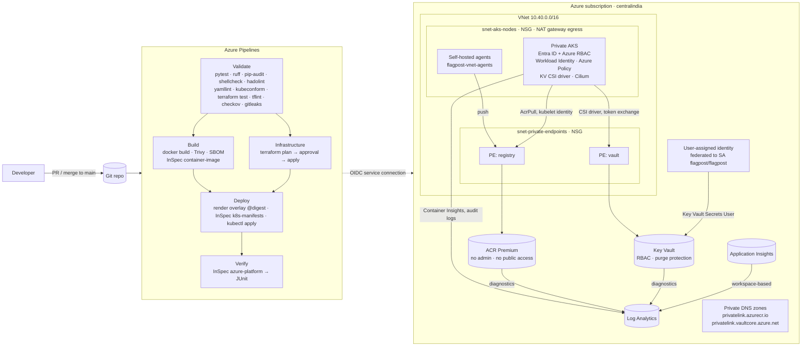

# AKS + ACR + Key Vault Compliance Platform

A production-style Azure delivery platform for a small containerised service, **Flagpost**
(a feature-flag evaluation API). The repo covers the full path from code to a private AKS
cluster, with compliance checks at three points: before the image is pushed, before the
manifests are applied, and after the Azure resources exist.

- **Terraform (azurerm 5.x)** modules for the network, Log Analytics + Application Insights,
  a private ACR, an RBAC-mode Key Vault, a private AKS cluster, and per-workload identities.
- **Private AKS** with Entra ID + Azure RBAC only (local accounts off), the OIDC issuer +
  **Workload Identity**, the **Azure Policy** add-on, the **Key Vault Secrets Store CSI driver**
  with rotation, Container Insights, Defender, Cilium network policy, NAT-gateway egress,
  and zone-spread autoscaling pools.
- **ACR Premium** with no admin user, no anonymous pull, no public network access, a private
  endpoint and geo-replication. AKS pulls with a bring-your-own kubelet identity that holds `AcrPull`.
- **Key Vault** with RBAC, purge protection, 90-day soft delete, a deny-by-default firewall,
  a private endpoint and audit logs. Secret values never enter Terraform state.
- **Kustomize** base + `aks-prod` / `local` overlays: restricted Pod Security, a read-only
  non-root container, a `SecretProviderClass`, PDB, HPA and default-deny NetworkPolicies.
- **InSpec (Cinc Auditor)** profiles: `azure-platform` (live Azure resources, inspec-azure),
  `k8s-manifests` (rendered YAML) and `container-image` (a running container).
- **Azure Pipelines** (`azure-pipelines.yml`): validate → build/scan/push → plan + approved
  apply → deploy → InSpec verification. It uses workload identity federation, so the
  pipeline stores no Azure secrets.

> Nothing in this repository has been deployed. All checks below run offline or on
> throwaway local containers and kind clusters. See [Limitations](#limitations).

## Architecture



Request path inside the cluster: client → `Service flagpost` (ClusterIP) → pods spread across
three zones. Each pod mounts `flagpost-api-key` from Key Vault at `/mnt/secrets-store` through
the CSI driver, using the Workload Identity token for its service account. The flag
definitions come from a Git-managed ConfigMap that the app hot-reloads.

## Repository layout

| Path | What it holds |
|---|---|
| `app/` | Flagpost (Python 3.13, Flask + gunicorn), seed flags, unit tests |
| `Dockerfile`, `compose.yaml` | Multi-stage image pinned by digest; local run with AKS-like constraints |
| `terraform/modules/{network,monitoring,acr,keyvault,aks,workload-identity}` | Reusable azurerm modules |
| `terraform/environments/prod` | Root module, `prod.tfvars` (placeholders), partial `azurerm` backend, mocked `terraform test` suites |
| `deploy/kustomize/` | `base`, `overlays/aks-prod` (ACR image, SecretProviderClass, Workload Identity), `overlays/local` (kind) |
| `compliance/` | InSpec profiles: `azure-platform`, `k8s-manifests`, `container-image` |
| `azure-pipelines.yml`, `pipelines/templates/` | Azure DevOps pipeline + step templates |
| `scripts/` | `check-all.sh`, smoke tests, renderer, dry-run bootstrap helpers, pinned tool installer |
| `tests/` | Repo policy tests, overlay renderer tests |

## The application: Flagpost

| Endpoint | Auth | Purpose |
|---|---|---|
| `GET /healthz` | none | liveness |
| `GET /readyz` | none | ready when flags are loaded **and** the API key is mounted |
| `GET /metrics` | none (cluster-internal) | Prometheus text: requests, latency histogram, evaluations, reloads |
| `GET /api/v1/info` | none | service, version, environment |
| `GET /api/v1/flags[/<key>]` | Bearer API key | flag definitions |
| `POST /api/v1/evaluate` | Bearer API key | `{"flag","tenant","subject"}` → `{"on","reason"}` |

Evaluation order: disabled → tenant deny list → tenant allow list → stable SHA-256 percentage
bucket of `flag:subject`. Flags are **read-only over HTTP**. Changes go through Git
(`app/seed/flags.json`, mirrored into the ConfigMap) and the pipeline, so every replica gives
the same answer. When Key Vault rotates the API key, the CSI driver rewrites the mounted file
and the app picks up the new key without a restart. If the key is missing, the API refuses
requests (503) instead of serving them unauthenticated.

## Run it locally

Requirements: Docker with Compose v2, Python 3.13, `make`. `make tools` installs pinned,
checksum-verified versions of terraform, tflint, kustomize, kubeconform, hadolint, gitleaks
and trivy into `.local/tools/bin`.

```bash
git clone https://github.com/shubhamkhedkar/aks-acr-keyvault-compliance-platform.git
cd aks-acr-keyvault-compliance-platform

python3 -m venv .venv && . .venv/bin/activate
pip install -r app/requirements-dev.txt -r requirements-ci.txt
make tools && export PATH="$PWD/.local/tools/bin:$PATH"

make test          # 57 pytest tests, coverage gate 90%
make up            # Flagpost on http://127.0.0.1:8080 with a throwaway API key
KEY=$(cat .local/secrets-store/flagpost-api-key)
curl -s -H "Authorization: Bearer $KEY" -H 'Content-Type: application/json' \
  -d '{"flag":"checkout-v2","tenant":"contoso","subject":"user-42"}' http://127.0.0.1:8080/api/v1/evaluate
make down
```

Rehearsals (Docker only; nothing leaves the machine):

```bash
make check         # every offline gate (same script the Validate stage runs)
make smoke         # compose: auth, evaluation, metrics, read-only FS, live key rotation
make scan          # Trivy, fails on fixable HIGH/CRITICAL
make compliance    # InSpec: rendered manifests (prod + local) and the running container
make kind-smoke    # throwaway kind cluster: restricted PSS, rollout, probes, API through port-forward
```

## Quality gates

| Gate | Tool | Scope |
|---|---|---|
| Unit + policy tests | pytest (+ coverage ≥ 90%) | app, overlay renderer, repo rules (no GitHub workflows, no secrets in TF, pipeline shape) |
| Lint / format | ruff, shellcheck, hadolint, yamllint | Python, scripts, Dockerfile, all YAML |
| Dependency audit | pip-audit; Trivy for the image | runtime requirements; OS + Python packages |
| Kubernetes schema | kustomize + kubeconform (strict, k8s 1.34, CRD catalog) | both overlays incl. `SecretProviderClass` |
| Terraform | fmt, validate, tflint (azurerm ruleset), `terraform test` with `mock_provider` | 20 plan-time guardrail tests across all modules, no Azure calls |
| Policy as code | Checkov | Terraform, Dockerfile, rendered production manifests |
| Compliance | InSpec / Cinc Auditor | manifests (pre-deploy), container (pre-push), Azure (post-deploy) |
| Secrets | gitleaks | git history + working tree |

Checkov exceptions are written inline with a reason: `CKV_AZURE_117` (no managed OS disk
to cover, since nodes use ephemeral OS disks with encryption at host) and `CKV_AZURE_164/166`
(image trust and scanning are handled by the pipeline and Defender rather than legacy
Docker Content Trust or quarantine).

## Deploy it yourself (when you choose to)

Everything below changes a real subscription and costs money. Private AKS (Standard tier),
ACR Premium with geo-replication, a NAT gateway and Defender are not free-tier services.

1. **State backend**: `./scripts/bootstrap-tfstate.sh` prints the `az` commands. Review
   them, then run with `--execute` after your own `az login`. Grant the pipeline identity
   *Storage Blob Data Contributor* on the account. Copy
   `terraform/environments/prod/backend.hcl.example` to `backend.hcl`.
2. **Entra ID**: create an AKS admin group and put its object ID in `prod.tfvars`
   (`aks_admin_group_object_ids`), along with your `subscription_id`, a `unique_suffix`
   and `alert_email`.
3. **Azure DevOps**:
   - Create an ARM service connection `sc-flagpost-prod` that uses **workload identity
     federation**. Give it Contributor and User Access Administrator (the platform creates
     role assignments) on the subscription or on a dedicated management group scope.
   - Create the environments `flagpost-prod-infra` and `flagpost-prod`, each with approvals.
   - Create the variable group `flagpost-prod` with `TF_STATE_STORAGE_ACCOUNT`,
     `AZURE_SUBSCRIPTION_ID` and `AZURE_TENANT_ID`.
   - Create the Key Vault-linked group `flagpost-inspec` with a Reader-only principal for
     InSpec (`INSPEC_READER_CLIENT_ID` / `INSPEC_READER_CLIENT_SECRET`).
4. **Network line of sight**: ACR, Key Vault and the AKS API are private. Register a
   self-hosted agent pool `flagpost-vnet-agents` on a VM or scale set inside the VNet
   (or a peered hub). The first `terraform apply` can run from such an agent, or from a
   workstation on a peered network.
5. **Infrastructure**: merge to `main`. The pipeline plans, waits for approval on
   `flagpost-prod-infra`, then applies the saved plan.
6. **Secret**: `./scripts/seed-keyvault-secret.sh --execute <key-vault-name>` from inside
   the VNet generates the API key straight into Key Vault with a 90-day expiry.
7. **App**: the Build stage pushes `flagpost@sha256:…`. Deploy renders `aks-prod` with the
   Terraform outputs (`scripts/render_aks_overlay.py` rejects placeholders and tags that are
   not digests), gates it with InSpec, and applies it with a kubelogin (Entra ID) token.
8. **Verify**: InSpec `azure-platform` (13 controls) runs against the live resources and
   publishes JUnit results to the run.

Manual equivalents (from a machine with private access):
`terraform -chdir=terraform/environments/prod init -backend-config=backend.hcl`,
`terraform plan -var-file=prod.tfvars -out tfplan`, `terraform apply tfplan`, then
`python3 scripts/render_aks_overlay.py <(terraform output -json) <acr>/flagpost@sha256:<digest> | kubectl apply -f -`.

## Operations notes

- **Secret rotation**: write a new version of `flagpost-api-key` in Key Vault. The CSI
  driver polls every 2 minutes and the app re-reads the file when its mtime changes. Callers
  must move to the new key at the same time, because only one key is valid.
- **Flag changes**: edit `app/seed/flags.json` and the mirror in `deploy/kustomize/base/`
  (a test enforces that they match), open a PR, and let the pipeline roll out the new
  ConfigMap hash.
- **Upgrades**: AKS uses the `patch` auto-upgrade channel and the `NodeImage` OS channel,
  inside Sunday and Saturday 02:00 IST maintenance windows. Bump `kubernetes_version` for
  minor upgrades.
- **Alerting**: the `oncall` action group emails `alert_email`. Set `availability_test_url`
  once the app is exposed through an ingress to enable the synthetic test and its alert.
- **Scaling**: gunicorn runs one process per pod (8 threads), so metrics and reload state
  stay coherent. The HPA (3–6 in prod) and the cluster autoscaler handle load.

## Limitations

- Not deployed. Terraform was validated and plan-tested against a **mocked** azurerm provider
  only. Real-API constraints (quotas, region and SKU availability for zones, ACR
  geo-replication, policy assignments in your tenant) are only discovered on a real plan or apply.
- The `azure-platform` InSpec profile and the Azure Pipelines YAML have been syntax- and
  structure-checked (`inspec check`, YAML lint, tests) but not run against Azure or Azure
  DevOps. Some inspec-azure property paths may need adjusting to the API versions in your tenant.
- inspec-azure only supports client-secret authentication, so the Verify stage needs one
  Reader-only service principal secret, kept in Key Vault. Everything else is secretless.
- kind uses a Kubernetes Secret where AKS uses the CSI driver, and kindnet does not enforce
  NetworkPolicy, so the kind run checks admission, rollout and probes but not network isolation.
- One API key for all callers. Per-client keys or Entra ID tokens on an ingress would be the
  next step. There is no ingress or WAF here, and the service is cluster-internal.
- Customer-managed keys (for ACR, disks and Log Analytics) are not configured. The design
  relies on platform-managed encryption plus encryption at host.

## Cleanup

Local: `make down && make clean`, and `kind delete cluster --name flagpost-smoke` if a kind
run was interrupted.

If you deployed it, remove the protections deliberately first:
1. Delete the `CanNotDelete` lock on `rg-flagpost-prod` (and `lock-tfstate` if you are
   removing the state account too).
2. Remove `prevent_destroy` from `terraform/modules/keyvault/main.tf`.
3. Run `terraform destroy -var-file=prod.tfvars`. The Key Vault stays soft-deleted for 90
   days and purge protection blocks an early purge, so plan a new `unique_suffix` if you
   recreate it sooner.
4. Delete the state storage account once nothing references it.

## Credits

Inspired by **DevOps-Project-07** ("DevOps journey using Azure DevOps": Terraform, AKS, ACR,
Key Vault, Application Insights and InSpec) in
[NotHarshhaa/DevOps-Projects](https://github.com/NotHarshhaa/DevOps-Projects/tree/master/DevOps-Project-07)
by [Harshhaa](https://github.com/NotHarshhaa). This repository is an independent
implementation: the application, modules, manifests, pipeline and compliance profiles were
written from scratch for this platform.

## License

MIT, see [LICENSE](LICENSE).
